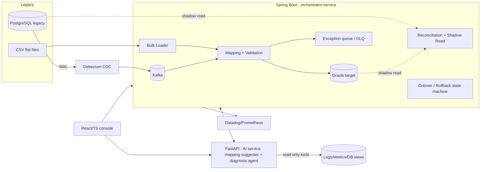

# Architecture & ADRs (Phase: Design)

## 1. System overview



## 2. Components
| Component | Tech | Responsibility |
|-----------|------|----------------|
| orchestrator-service | Spring Boot | Run lifecycle, load, CDC consumer, mapping, reconciliation, cutover state machine, REST API |
| ai-service | FastAPI | Mapping suggestions, diagnosis agent (read-only tools), evals |
| console | React + TS | Progress, diffs, exceptions, approvals, agent chat |
| Kafka + Debezium | Infra | Ordered change events (key = loan_id) |
| Oracle | Target DB | Business tables + `MIG_*` control tables (Liquibase managed) |

## 3. Cutover state machine
`PLANNED -> PROFILED -> INITIAL_LOAD -> CDC_SYNC -> SHADOW_VERIFY -> READY -> FREEZE -> FINAL_SYNC -> SWITCHED -> MONITOR -> DONE`
Rollback allowed from `FREEZE`, `FINAL_SYNC`, `SWITCHED`, `MONITOR`  (reverse sync keeps legacy current until DONE).
Every transition needs pre-check pass + audit entry; `SWITCHED` requires human approval.

## 4. ADRs

### ADR-1: Debezium CDC over dual-write
- Context: need continuous sync without changing the legacy app.
- Decision: log-based CDC (Debezium on Postgres WAL) into Kafka.
- Why: dual-write risks partial failure and needs legacy code changes. CDC is non-intrusive, ordered, replayable.
- Trade-off: more infrastructure; WAL retention must be monitored.

### ADR-2: Idempotent upsert keyed by legacy id
- Decision: every write is `MERGE` on `(tenant, legacy_id)` with a `source_version` guard; the `MIG_ID_XREF` table links ids.
- Why: Kafka is at-least-once; replays must not duplicate money.

### ADR-3: Quarantine, never drop
- Decision: invalid rows go to `MIG_EXCEPTION` with a reason code, raw payload and run id; reconciliation counts = loaded + quarantined.

### ADR-4: AI agent is read-only with approval gate
- Decision: the agent can only call read tools (logs, metrics, whitelisted SQL views). Any proposed action is returned as a suggestion and requires a human click.
- Why: safety on financial data; PII masked before prompts; every tool call logged for evals.

### ADR-5: Provider-agnostic LLM interface
- Decision: `LlmClient` interface with OpenAI-compatible and Ollama adapters.
- Why: no lock-in, enables model comparison in evals, offline development.

### ADR-6: Liquibase for Oracle schema
- Decision: all DDL in Liquibase changelogs; no hardcoded schema names in code (schema from config).

## 4b. Risk register (updated)
See 01-requirements.md section 7. New: Debezium connector lag (alert on lag > 30 s), Oracle XE size limits (use sampled data in dev).

## 5. Repo layout (planned)
```
migration-orchestrator/
  orchestrator-service/   (Spring Boot, Maven)
  ai-service/             (FastAPI)
  console/                (React + TS)
  legacy-data/            (generator, profiler)
  docs/
  docker-compose.yml
```
